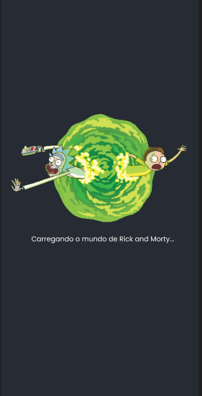
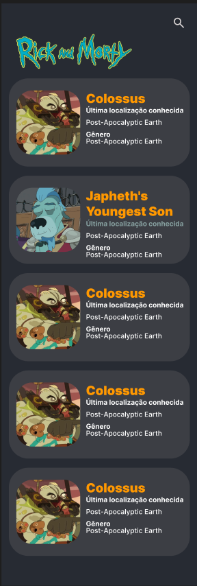
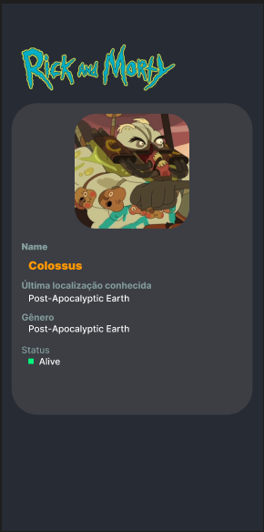

# Rick And Morty - App em Flutter


## Um aplicativo Flutter para Android que consome a [The Rick and Morty API](https://rickandmortyapi.com/) para exibir, buscar e paginar personagens do universo de Rick and Morty, construído com foco em arquitetura limpa e testabilidade.

## 📜 Sumário

- [Sobre o Projeto](#-sobre-o-projeto)
- [Funcionalidades](#-funcionalidades)
- [Padrões](#-padrões)
- [Estrutura de Pasta](#-estrutura-de-pastas)
- [Pré-requisitos](#-pré-requisitos)
- [Como Rodar o Projeto](#-como-rodar-o-projeto)
- [Melhorias Futuras](#-melhorias-futuras)

---

## 📖 Sobre o Projeto

Esta aplicação foi desenvolvida como um cliente móvel para a API pública de Rick and Morty. O objetivo principal foi construir um aplicativo robusto e escalável, aplicando as melhores práticas de desenvolvimento Flutter, como separação de responsabilidades, gerenciamento de estado reativo e um design de código testável.

O projeto inclui funcionalidades como busca em tempo real, paginação (rolagem infinita) e uma navegação fluida entre a lista de personagens e a tela de detalhes.

---

## ✨ Funcionalidades

- Splash Screen: Tela de boas-vindas que carrega os dados iniciais de forma assíncrona.
- Lista de Personagens: Exibe uma lista paginada de personagens que carrega mais itens conforme o usuário rola a tela.
- Busca em Tempo Real: Permite filtrar personagens por nome, com um debounce para otimizar as chamadas à API e evitar requisições excessivas.
- Tela de Detalhes: Mostra informações detalhadas de um personagem selecionado, incluindo status (com indicador visual), espécie, gênero e localização.
- Arquitetura Limpa: O código é organizado seguindo o padrão MVVM, garantindo que a UI, a lógica de apresentação e os dados sejam desacoplados.

---

## 📋 Padrões de projetos utilizados

1. **MVVM (`Model-View-ViewModel`)**: Utilizado para separar a lógica de apresentação (`ViewModel`) da interface do usuário (`View`), tornando o código mais organizado e testável.

2. **Repository Pattern**: Abstrai a camada de acesso a dados. O ViewModel depende de uma interface (`CharacterRepository`), não de uma implementação concreta, permitindo trocar a fonte de dados (`API`, `cache`, `mock`) sem alterar a lógica de negócio.

3. **Injeção de Dependência (DI)**: Centraliza a criação e o fornecimento de dependências (como `Repository` e `ViewModel`) usando o pacote provider. Isso remove o acoplamento direto e facilita a manutenção e os testes.

4. **State Object Pattern**: O estado da UI é encapsulado em uma única classe imutável (`CharacterListViewState`), tornando as transições de estado mais previsíveis e fáceis de depurar.

## 📁 Estrutura de Pastas

```
lib/
├── core/ # Código compartilhado e configurações centrais
│ ├── di/ # Injeção de dependência
│ └── theme/ # Cores e estilos de texto padronizados
├── models/ # Classes de modelo (ex: Character)
├── repositories/ # Camada de acesso a dados
│ ├── abstract/ # Contratos (interfaces) dos repositórios
│ └── character_repository_impl.dart
├── view_models/ # Lógica de apresentação (ViewModels) e classes de estado
├── views/ # Widgets que representam as telas
│ ├── widgets/ # Widgets reutilizáveis (cards, app bars)
│ ├── home_screen.dart
│ ├── character_detail_screen.dart
│ └── splash_screen.dart
├── main.dart # Ponto de entrada da aplicação
test/
└── view_models/ # Testes unitários para os ViewModels
```

## 📋 Pré-requisitos

- Flutter SDK (versão 3.x ou superior)
- Um editor de código como VS Code ou Android Studio
- Um emulador Android configurado ou um dispositivo físico

## 🚀 Como Rodar o Projeto

Siga os passos abaixo para executar a aplicação localmente.

### 1. Clone o repositório

```bash
git clone https://github.com/AdsonBruno/rick-and_morty-app
cd rick_and_morty_app
```

### 2. Instale as dependências

```bash
flutter pub get
```

### 3. Executando a Aplicação

- Conecte um dispositivo ou inicie um emulador e rode o comando:

```bash
 flutter run
```

### 4. Rodando os testes

```bash
flutter run
```

### 🔮 Melhorias futuras

- **Refatoração**: Investir em refatorar para corrigir mais detalhes de implementações, correção de acoplamentos desnecessários e deixar as telas mais responsivas
- **Cache de Dados**: Implementar um cache local (`usando shared_preferences` ou `Hive`) para armazenar os personagens, melhorar a performance em inicializações futuras e permitir o uso offline básico.
- **Tela de Episódios e Localizações**: Expandir a aplicação para incluir as outras seções da API, criando novos Models, Repositories e Views.
- **Favoritos**: Adicionar uma funcionalidade para que o usuário possa marcar personagens como favoritos, salvando-os localmente.
- **UI/UX Refinada**: Adicionar animações e transições (como Hero animations na imagem do personagem) para tornar a navegação entre a lista e a tela de detalhes mais fluida.
- **Tratamento de Erros Aprimorado**: Exibir mensagens de erro mais amigáveis e específicas para o usuário

## Prototipos de telas

- Aqui mostro as capturas de tela para o projeto

| Splash Screen | Home | Detalhes do personagem |
|---|---|---|
||||

- É possível também ver o projeto das telas no figma no link [Protótipo de Telas](https://www.figma.com/design/zHRwaKCcc38buqjtYD5zXk/App-Rick-And-Morty?node-id=0-1&p=f)
